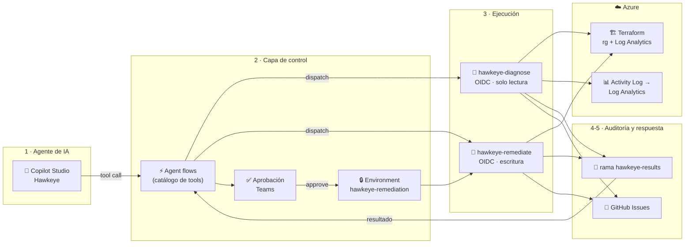

# 🏹 Modo Hawkeye

**Observabilidad y control para agentes de IA que administran infraestructura cloud.**
Un agente en Microsoft Copilot Studio detecta *configuration drift* en Azure, presenta la evidencia (qué cambió, quién y cuándo) y solicita una corrección que **solo se ejecuta tras aprobación humana**, con una identidad distinta y verificación del plan.

> La observabilidad empieza desde el momento en que el agente solicita una acción,
> **pero la seguridad debe estar en la ruta de ejecución.**

## Arquitectura



## Controles

| Control | Implementación |
|---|---|
| Sin secretos | OIDC entre GitHub Actions y Entra ID; no existe `AZURE_CLIENT_SECRET` |
| Separación de funciones | `gha-modo-hawkeye-reader` (diagnóstico) vs `gha-modo-hawkeye` (corrección) |
| Mínimo privilegio | Rol custom *Hawkeye Drift Reader* y *Contributor* acotados al RG del laboratorio |
| Aprobación en la ruta | La identidad de escritura solo confía en tokens del environment `hawkeye-remediation`, que exige reviewer |
| Lo aprobado es lo ejecutado | Huella SHA‑256 del plan; si Azure cambió, la corrección se bloquea |
| Política | Hawkeye nunca elimina ni reemplaza recursos |
| Verificación | Tras el apply se re‑planifica y se exige 0 diferencias |
| Auditoría | Cada diagnóstico/corrección queda en la rama `hawkeye-results` y en un issue |
| Repo público seguro | El plan nunca se publica; solo un resumen con atributos en lista blanca |

## Estructura

```
infra/                       Terraform (rg-modo-hawkeye-demo + law-modo-hawkeye-demo)
scripts/
  bootstrap.sh               Identidades, rol custom, environment, secrets (Cloud Shell)
  inject-drift.sh            Simula el cambio manual para la demo
  summarize-plan.sh/.jq      Plan → resumen seguro + huella
  collect-evidence.sh        KQL AzureActivity (fallback: API Activity Log)
  publish-result.sh          Publica resultados en la rama hawkeye-results
.github/workflows/
  hawkeye-diagnose.yml       Diagnóstico (solo lectura)
  hawkeye-remediate.yml      Corrección (aprobación + huella + verificación)
  azure-login.yml            Prueba de OIDC
docs/
  DEMO-GUIDE.md              Puesta en marcha, guion y troubleshooting
  copilot-studio/            Agente, 4 agent flows y esquemas JSON
```

## Inicio rápido
1. `bash scripts/bootstrap.sh` en Azure Cloud Shell
2. Probar workflows a mano (ver `docs/DEMO-GUIDE.md` §A3)
3. Configurar Copilot Studio (`docs/copilot-studio/`)

Proyecto de [CloudExpeditioners](https://github.com/CloudExpeditioners) · Jorge Luis Avila
