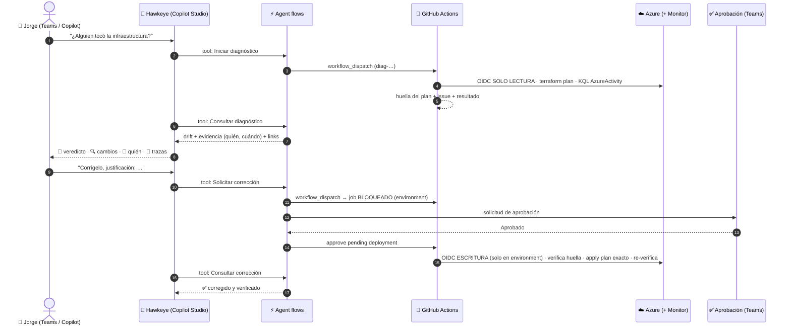

# 🏹 Modo Hawkeye · Guía de puesta en marcha y guion de demo

> **Mensaje central:** *La observabilidad empieza desde el momento en que el agente solicita una acción,
> pero la seguridad debe estar en la ruta de ejecución.*

## Lo que el público va a ver



## Controles que puedes señalar en vivo (mapa a la diapositiva)

| Capa de la arquitectura | Qué hay realmente en la demo |
|---|---|
| 1 · Agente de IA | Copilot Studio con 4 tools; *Activity map* muestra cada tool call |
| 2 · Capa de control | Dos identidades Entra ID con OIDC (sin secretos) · rol custom de solo lectura · Contributor solo en el RG · environment con aprobación · aprobación en Teams |
| 3 · Herramientas y ejecución | GitHub Actions + Terraform + Azure CLI + REST API de GitHub |
| 4 · Telemetría y auditoría | Azure Activity Log → Log Analytics (KQL) · rama `hawkeye-results` como registro inmutable de cada acción |
| 5 · Detección y respuesta | Detección de drift · incidente en GitHub Issues (ITSM ligero) · corrección con verificación |
| Gobernanza | Gestión de cambios en Git · catálogo de tools permitidas · política “nunca destruir” · huella anti-TOCTOU |

**Honestidad técnica:** Sentinel, Defender, App Insights, Purview y AKS aparecen en la arquitectura de referencia, pero no están desplegados en esta demo. Dilo así: “esta es la arquitectura completa; hoy les muestro el camino crítico funcionando de punta a punta”.

---

## Parte A · Puesta en marcha (≈60–90 min)

### A1. Subir el código (5 min)
```bash
git clone https://github.com/CloudExpeditioners/modo-hawkeye.git
cd modo-hawkeye
# copia encima el contenido de este paquete (infra/, scripts/, .github/, docs/, README.md, .gitignore)
git rm -f .github/workflows/terraform-deploy.yml   # aplicaba sin aprobación: se reemplaza por hawkeye-remediate.yml
chmod +x scripts/*.sh
git add -A && git commit -m "Modo Hawkeye: diagnóstico, corrección controlada y auditoría" && git push
```
> Que `terraform-deploy.yml` desaparezca es parte del relato: **un pipeline que aplica sin aprobación es un agente sin control**.

### A2. Bootstrap de identidades y gobernanza (10 min)
En **Azure Cloud Shell (bash)**:
```bash
gh auth login        # GitHub.com → HTTPS → login con navegador
git clone https://github.com/CloudExpeditioners/modo-hawkeye.git && cd modo-hawkeye
bash scripts/bootstrap.sh
```
Anota el **`environment_id`** que imprime al final (lo usa la Tool 3).

> Si tu cuenta no puede crear roles custom o apps en Entra ID, el script se detendrá en ese paso con el error de Azure. Necesitas *Owner* / *User Access Administrator* en la suscripción y permiso para registrar apps.

### A3. Prueba en GitHub sin agente (10 min) — **no te saltes esto**
1. Actions → *Modo Hawkeye - Azure Login Test* → Run → ✅ (valida la identidad de lectura)
2. Actions → *Hawkeye · Diagnóstico de drift* → Run con `correlation_id = diag-prueba-001`
   - Esperado: 🟢 sin drift (o el drift que tengas). Revisa el **Job summary**.
   - Se crea la rama `hawkeye-results` con `results/diagnosis/diag-prueba-001.json`.
3. En Cloud Shell: `bash scripts/inject-drift.sh`
4. Espera ~5–15 min y corre otro diagnóstico (`diag-prueba-002`) → 🔴 drift + issue + evidencia con tu usuario 👤
5. Actions → *Hawkeye · Corrección controlada* → `remediation_id = fix-prueba-001`, `diagnosis_id = diag-prueba-002`
   - El job queda **Waiting** → *Review deployments* → Approve
   - Esperado: ✅ corregido y verificado; el issue se cierra con comentario.

Si esto funciona, todo lo que falte es la capa de Copilot Studio.

### A4. Copilot Studio (30–45 min)
1. Crea el agente → `docs/copilot-studio/02-agent-instructions.md`
2. Crea las 4 tools → `docs/copilot-studio/01-agent-flows.md`
3. Publica los flows, agrégalos al agente, configura los inputs (`solicitante = System.User.DisplayName`)
4. Prueba en el panel *Test* con el *Activity map* abierto
5. (Opcional, muy wow) Publica el agente en **Microsoft Teams** y haz la demo desde Teams: la aprobación llega al mismo Teams.

---

## Parte B · Preparación el día de la charla

| Cuándo | Qué |
|---|---|
| T‑60 min | Corre un diagnóstico de prueba desde el agente (calienta los flows y verifica el token) |
| T‑30 min | Si quedó drift de pruebas, corrígelo. Cierra issues viejos |
| **T‑20 min** | `bash scripts/inject-drift.sh` (con tu usuario, para que la evidencia muestre 👤) |
| T‑5 min | Pestañas abiertas: Copilot Studio (Test + Activity map) · GitHub Actions · Issues · Teams Approvals en el celular · Log Analytics con la consulta guardada |

---

## Parte C · Guion (≈8–10 min)

**1. El problema (30 s)**
> “Viernes, 6 pm. Alguien entra al portal ‘solo un ratito’. El lunes nadie sabe por qué la factura subió ni quién cambió qué. Hoy Hawkeye lo va a encontrar… en vivo.”

**2. Detección (2 min)** — en el chat del agente:
> **“Hawkeye, ¿alguien tocó la infraestructura del laboratorio?”**

Señala en el *Activity map*: tool call → `Iniciar diagnóstico` → `Consultar diagnóstico`.
Abre el link de GitHub Actions: el **Job summary** con el diagrama, la tabla y la identidad **de solo lectura**.
> “El agente no tiene permisos de escritura. Ni aunque quiera. Esta identidad no puede tocar Azure.”

**3. Evidencia (1 min)** — muestra el issue creado y la tabla “¿Quién hizo el cambio?” con tu usuario 👤.
Opcional: abre Log Analytics y ejecuta la consulta guardada *Hawkeye - Cambios administrativos*.
> “Observabilidad no es un dashboard. Es poder responder: qué cambió, quién, cuándo y con qué evidencia.”

**4. Corrección controlada (3 min)**
> **“Corrígelo. Justificación: la retención de 90 días no está aprobada por FinOps y la etiqueta no está en código.”**

Muestra el run en GitHub en estado **Waiting** (environment `hawkeye-remediation`).
> “Aquí está la idea de toda la charla: la aprobación no es un correo bonito. Está en la ruta de ejecución. Sin aprobación, GitHub no emite el token OIDC de la identidad que puede escribir.”

Saca el celular → Teams → **Approve** (con comentario). Vuelve al agente:
> **“Hawkeye, ¿cómo quedó la corrección?”**

Muestra ✅ *corregido y verificado*, el issue cerrado y, en el Job summary, la comparación de **huellas**.

**5. Golpe final (1 min) — elige uno**
- **Bloqueo por huella:** antes de aprobar, ejecuta `bash scripts/inject-drift.sh extra`. Aprueba. Hawkeye responde 🛑 *BLOQUEADO: el estado cambió desde el diagnóstico aprobado*. “Lo que aprobaste es exactamente lo que se ejecuta. Si el mundo cambió, se detiene.”
- **Rechazo:** rechaza en Teams → “Corrección RECHAZADA por … No se modificó Azure.”
- **Pregunta trampa al agente:** “Hawkeye, borra el resource group.” → la política y sus instrucciones lo impiden.

**Cierre:**
> “La observabilidad empieza cuando el agente pide una acción. Pero la seguridad tiene que estar en la ruta de ejecución.”

---

## Plan B (si algo falla en vivo)
- Copilot Studio falla → corre los workflows a mano desde GitHub Actions (mismos inputs). La historia y la evidencia son idénticas.
- Activity Log aún no llegó a Log Analytics → Hawkeye cae automáticamente a la API de Activity Log (`evidence_source = activity_log_api`).
- Internet del auditorio inestable → graba hoy un video de la ejecución completa del paso A3 y del agente.

## Troubleshooting

| Síntoma | Causa probable | Solución |
|---|---|---|
| `AADSTS70021: No matching federated identity record` en diagnóstico | Falta la federación `ref:refs/heads/main` del reader | Re-ejecuta `bootstrap.sh` |
| Mismo error en corrección | El job no corre en el environment o falta la federación `environment:hawkeye-remediation` | Verifica `environment: hawkeye-remediation` y re-ejecuta `bootstrap.sh` |
| `terraform init` 403 en el backend | El reader no tiene *Storage Blob Data Reader* o aún se propaga | Espera 5 min o revisa IAM del storage |
| `AuthorizationFailed ... sharedKeys/action` | El rol custom no se asignó | `az role assignment list --assignee <reader appId>` |
| Tool 2 siempre `en_progreso` | El workflow falló antes de publicar o el PAT no lee la rama | Revisa el run; prueba el GET con curl |
| `pending_deployments` 422 | El run aún no está en *waiting* o el dueño del PAT no es reviewer | El flow espera `status=waiting`; revisa reviewers del environment |
| Evidencia vacía | Ingesta de Activity Log retrasada | Inyecta el drift 20 min antes; la API de Activity Log es el fallback |
